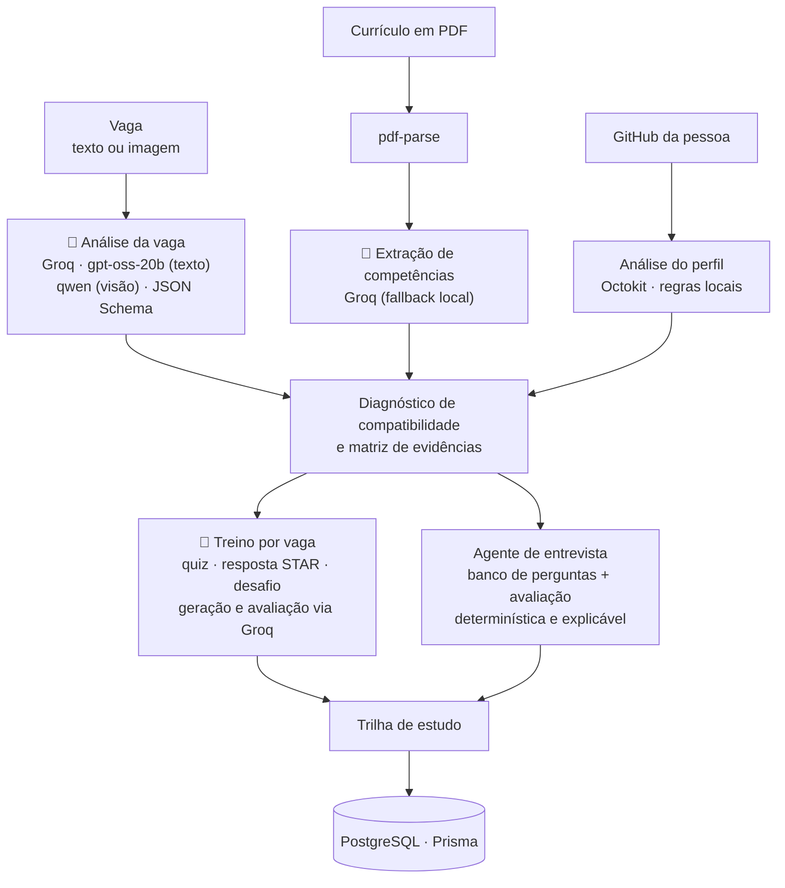

# DevReady

Plataforma de preparação para processos seletivos de tecnologia: a pessoa cola uma vaga, o sistema extrai o que ela exige, cruza com o currículo e o GitHub, e monta treino, simulação de entrevista e trilha de estudo.

<!-- DEMO -->

## O problema

Profissionais juniores encontram descrições de vaga extensas e pouco claras, e têm dificuldade de transformar o resultado de um processo em um plano de evolução. O DevReady guia o caminho completo: interpretar os requisitos da vaga, produzir um diagnóstico explicável, praticar competências técnicas e comportamentais, simular a entrevista e transformar o desempenho em um plano de estudo.

## Como funciona



Pontos de IA no código:

- **LLM (Groq):** análise da descrição da vaga, geração e avaliação do treino por vaga (`lib/groq-job-training.ts`, com saída validada por JSON Schema) e extração de competências do currículo (`lib/extraction.ts`). Modelos padrão: `openai/gpt-oss-20b` para texto e `qwen` para imagem. Sem a chave da Groq, a análise cai em regras locais.
- **Agente de entrevista:** funciona com banco de perguntas (35 por área técnica) e **avaliação determinística e explicável** por conteúdo, clareza, evidências e estrutura. Não usa LLM.
- **Análise do GitHub:** feita com Octokit e regras locais, sem LLM.
- **Voz, tool calling e MCP:** o projeto não usa.

## Stack

- Next.js (App Router), React e TypeScript
- Prisma e PostgreSQL, Better Auth para autenticação
- Groq (LLM), `pdf-parse` e Octokit (GitHub)
- Implantado na Vercel

## Meu papel

Projeto em equipe, feito no hackathon. Fiquei com **autenticação, cadastro e análise de perfil**:

- autenticação e cadastro com Better Auth, incluindo a validação de senha;
- modelo de currículo, upload e conversão do PDF, e a extração de competências com Groq;
- análise do GitHub (backend e componente no dashboard) e a rota de status do processamento.

As demais partes foram de outras pessoas do time: dashboard, privacidade e agente de entrevista (Isabela Duarte), design e trilha de estudo (Eduarda) e sessões de treino por vaga (Geovanna).

## Contexto

Projeto do **Hackathon Comunidade Juninhos & Nortjobs**, **2º lugar**. Esta é a minha cópia (fork) do repositório oficial da equipe: https://github.com/juninhos-comunidade/devready

## Demonstração

Aplicação publicada: https://devready.vercel.app. O README original descreve uma conta de demonstração com dados fictícios. Não testei o site nesta revisão.

## Como rodar localmente

Requisitos: Node.js 22, npm e um PostgreSQL.

```bash
git clone https://github.com/Jp-mainieri/devready.git
cd devready
npm install
cp .env.example .env
```

No `.env`, configure `DATABASE_URL`, o segredo do Better Auth e, opcionalmente, `GROQ_API_KEY`. Sem a chave, a análise usa regras locais. Depois:

```bash
npm run db:migrate   # aplica as migrações do Prisma
npm run dev          # http://localhost:3000
npm test             # testes locais
npm run check        # lint, typecheck, testes e build
```

Variáveis e detalhes de produção estão em `.env.example` e na documentação do repositório original.
